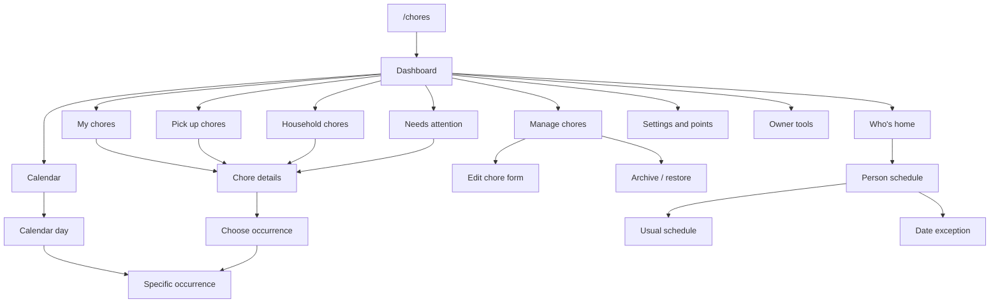

# Sprig page and interaction map

See [user-task audit findings](TASK-AUDIT-FINDINGS.md) for supported, awkward, missing and restricted goals.

For screen purposes, control behavior and task acceptance criteria, see [Interface specification](INTERFACE-SPEC.md).
Snapshot: October 22, 2026. Describes the prepared 1.3.2 interface, including changes not yet deployed. This is a navigation inventory, not proof that every Discord interaction has been exercised live. Conditional actions appear only when the chore, person, or permission allows them.

## Main routes

Calendar opens today directly; Week and Month are alternative calendar scopes. Calendar day Details selects a dated occurrence when one exists; flexible chores can lead to the regular card instead.

## The shared page frame

| Position | Meaning |
| --- | --- |
| Top | Page name and contextual ? at the top right |
| Main area | Readable records, chore details, or settings |
| Below records | Page count, then fixed Previous / Next |
| Below paging | View controls and occasional-action menus |
| Bottom navigation | Back when available, Refresh, Dashboard |
| Last row | Temporary Undo actions, when available |

Back follows the page's saved parent route. Refresh restores current data without repeating the previous action. Expired controls recover the saved screen when possible. Dashboard is always the household starting page. Discord modal forms are pop-ups, not full pages; help belongs to the page opening the form.

## Find and do chores

| Page | What you see | Where actions lead |
| --- | --- | --- |
| My chores | Your responsibilities; Due now, This week, Next week, Upcoming, Completed | Chore name → Chore details; available Claim/Done/Skip act on that occurrence; future date choice → occurrence picker |
| Pick up chores | Work available to pick up, with time views | Chore name → Chore details; Claim takes this occurrence; date choice picks future work |
| Household chores | Shared assignments; grouping by person, chore, or time | Chore name → Chore details; grouping/search/filter change this list |
| Needs attention | Overdue, unclaimed, and blocked work, each chore once | Details beside a row → Chore details; Back retains list page |
| Search / Filters | Query, room/status/date and related view choices | Apply → originating list; changes the view, not the chore |
| Calendar day | Scheduled work for a selected date | Details → dated occurrence where supported; Previous/Next page retain date; Previous day / Today / Next day change date |
| Calendar week / month | Schedule overview | Choose a day → Calendar day; scope controls switch week/month |
| Chore details | Owner, schedule, status, points, room, instructions and checklist information | Everyday actions visible; two menus contain occasional actions |

### Chore details actions

| Group | Actions and destination | Effect |
| --- | --- | --- |
| This occurrence | Claim, Done, Checklist, Skip, Undo completion, Stuck / need help, Choose occurrence | Changes or inspects this occurrence; unavailable actions are omitted |
| Responsibility menu | Signup options, This/Next week take/release, Sign-up schedule, ongoing ownership | Changes duration or repeating responsibility |
| Responsibility menu | Reassign | Choose responsibility scope and recipient; preserve earned history |
| Responsibility menu | Drop responsibility | Release the selected scope; repeating ownership can open the repeating schedule editor |
| Responsibility menu | Propose trade | Choose recipient/exchange; proposal waits for the other person's acceptance |
| Schedule & details menu | Edit chore, Change schedule, Change regular day | Prefilled editing form or schedule choices |
| Schedule & details menu | Move this occurrence / Cancel occurrence move | Move one occurrence or return it to the normal schedule |
| Schedule & details menu | Estimate / checklist | Edit estimate and checklist instructions |
| Schedule & details menu | Duplicate chore | Prefilled copy form; creates a separate chore |
| Schedule & details menu | Give feedback | Feedback form about instructions, timing, points, or other concerns |
| Schedule & details menu | Completion history | Recorded completions and available corrections |
| Schedule & details menu | Separate AM and PM sign-ups, when applicable | Confirm a split into independent shifts |

### Occurrence, signup, and recovery pages

| Page or form | Main interaction | Return / safeguards |
| --- | --- | --- |
| Choose occurrence / date / shift | Select the exact date and AM/PM slot | Opens that occurrence, not a changed regular schedule |
| Specific occurrence | Claim just this time, Skip just this time, drop dated claim where applicable | Preserves later repeats and weekly signups; future completion is unavailable |
| Signup options | Choose one occurrence, weekly, ongoing, or repeating slots where supported | Conflicting ownership and attendance are checked |
| Repeating sign-up schedule | Toggle weekdays/shifts, then Save once | Saved selection prefilled; applies only when home |
| Checklist | Toggle individual steps; Done when requirements are met | Completion returns through its saved parent |
| Stuck / need help | Choose status and enter explanation; resolve/update status | Adds context without completing or dropping the chore |
| Help-status history | Inspect recorded help/status changes | Returns to its chore context |
| Completion history | Review a completion; request supported correction | Personal undo is restricted; owner-assisted corrections are owner only |
| Undo completion confirmation | Confirm reversal | Reverses recorded points/streak effects only when safe |
| Skip Undo | Temporary bottom action | Reverses only the unchanged skipped occurrence, with no points |
| Trade inbox | Review incoming/outgoing requests; accept, decline, or cancel where permitted | Revalidates ownership before an accepted trade |
| Trade proposal | Choose recipient and exchange | Does not transfer work until accepted |
| Confirmation | Inspect proposed consequential change; Confirm or Cancel | Cancel returns without applying it |

**Immediate recovery:** Done and Skip both offer bottom Undo controls. Undo Done reverses the latest unchanged completion immediately, including points and streak effects; stale changes are rejected.

## Manage the chore catalog

| Page | Interaction |
| --- | --- |
| Manage chores | Active catalog with inline Edit; Search, paging, Add chore, Archive chore, Archived chores |
| Add chore | Choose repeat pattern, fill in name/points/instructions, submit |
| Edit chore | Prefilled form; save returns to the catalog's search/page |
| Schedule editor | Repeat pattern, weekday, and missed-work choices as applicable |
| Archive chore | Readable active list + dropdown; select a chore and confirm archive |
| Archived / Archived chores | Readable archived list + dropdown; select, then Restore |

Archive hides a chore; points and completion history remain saved. Restore is not a new chore. Shared catalog management is not restricted to the bot owner.

## Attendance and coordination

| Page | Interaction |
| --- | --- |
| Who's home | Paged known-household roster showing scheduled Home/Away now; Change beside each person; picker supports multiple people |
| Selected person's schedule | Home today / Away today, other date shortcuts, saved exceptions, Usual schedule |
| Usual schedule | Home daily, away daily, chosen weekdays, or alternating weeks; review/save or restore household default |
| Date exception form and preview | Enter a date/range and Home/Away, review, confirm |
| Saved exception | Inspect/cancel the recorded override where permitted |
| Household setup | Configure alternating accounts and household rotation; setup permission required |

Attendance comes from saved schedules, not Discord presence. Date exceptions override defaults. Kas/Zel's default handoff remains Sunday at 6 p.m. Eastern. Changing attendance does not automatically remove responsibilities.

## Personal settings, points, and owner tools

| Page | Interaction / destination | Access |
| --- | --- | --- |
| Reminders | Enable/disable; edit up to ten daily times and supported preferences | Your account |
| Notifications | Personal notification preferences | Your account |
| List length | Set personal page-size preference within supported bounds | Your account |
| Points & standings | Your balance/streak and household rankings | Household |
| Workload & pace | Past earned averages and projected responsibility; calendar-day and home-day comparisons | Household |
| Review inbox | Read feedback, update/review it, reopen resolved reviews | Owner only |
| Update announcements | Automatic announcement switch; Announce this update | Owner only |
| Reset points | Select person/everyone and whether streaks reset; confirm | Owner only |
| Reset history / Undo | Inspect resets; undo when the affected state permits | Owner only |
| Completion corrections | Correct another person's completion through history | Owner only |
| Help | Topic dropdown and short guide | Household |
| Page ? | Help for the current page; return to that page | Household |
| Continue where I left off | Restore saved navigation context | Your account |

## Design decisions this map exposes

1. **One chore destination.** Names and Details should lead to the same chore information; future occurrence selection must be explicit.
2. **Records belong beside their actions.** Attention and calendar use readable rows with Details; archives use a list plus dropdown.
3. **One home for occasional actions.** Responsibility and Schedule & details menus replace the card's button wall.
4. **Consistent management language.** Archive / Archived chores / Restore are used throughout; internal legacy identifiers remain compatible.
5. **Explicit settings scope.** Chore reminders controls scheduled due-work DMs; Trade alerts controls new proposal DMs. The preferences are independent.
6. **Predictable Undo.** Both Done and Skip expose immediate bottom Undo, subject to safe-state checks.
7. **Routes must keep context.** Back should retain date, page, search, and grouping; recovery must never replay a saved mutation.

## Maintenance and verification

Primary implementation: chore_workspace.py (pages/navigation), chore_pages.py (shared frame), chore_planning.py (calendar/checklists/reminders/help statuses), chore_board.py (catalog, assignments, reviews and trades), chore_recovery.py (screen restoration), plus repeating/dated/attendance/insights helpers. USER-GUIDE.md is the user-facing procedure reference; PAGE-TEMPLATES.md is the reusable layout contract.

Update this map when adding a destination, changing action scope, moving a control into a menu, or changing Back behavior. For each change, check destination, privacy/access, page context, stale-state handling, and mutation/history effects. This map deliberately does not give exact click counts: modal typing, conditional controls, and saved selections change those counts.
